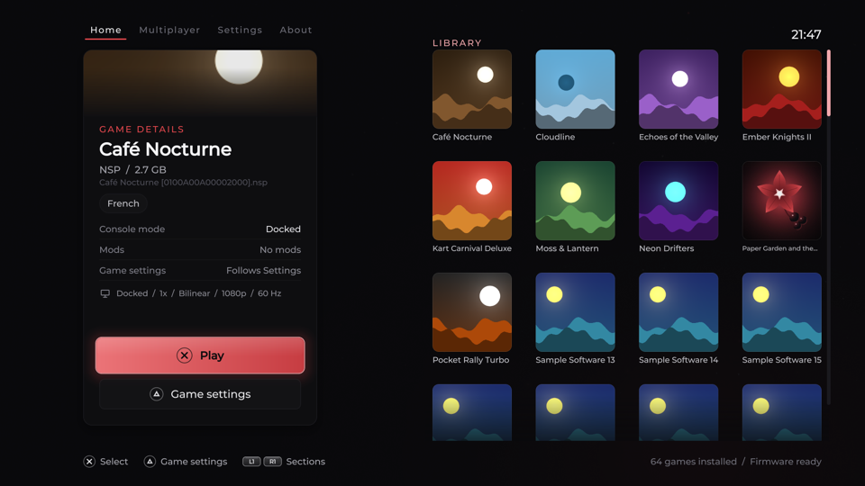
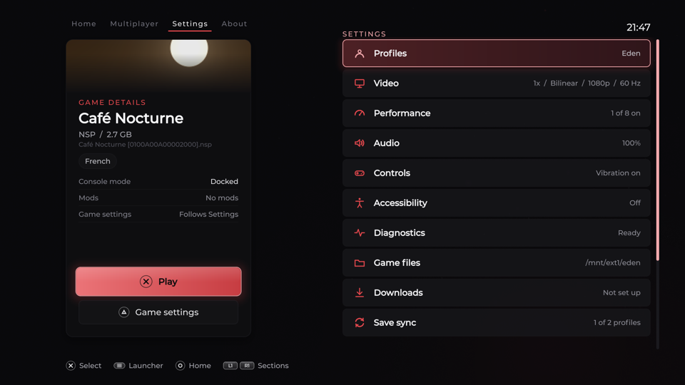
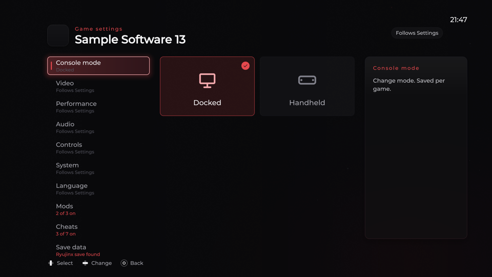

  

<h1 align="center">Nightshade</h1>

  <strong>The Switch emulator for PS5 homebrew that keeps up: faster starts, fewer crashes, Switch 2 in testing.</strong>

  
  
  
  

Nightshade runs your own Switch games on a jailbroken PS5. It is made by **[Oliv3rmoon](https://github.com/Oliv3rmoon)**: big games start right away, long sessions last, the emulator gives memory back to the console, and the launcher has a look of its own in black and red. Every release lists exactly what is in it: see [Releases](https://github.com/Oliv3rmoon/Nightshade/releases) and the [changelog](docs/CHANGELOG.md).

  
  
  

The Nightshade theme, drawn by the launcher's host preview with sample games.

## Why Nightshade

- **A look of its own.** The Nightshade theme is the default: black and red, with accent presets (Red, Crimson, Rose, White, Violet, Ice), a red nightshade flower for the icon and home screen, and wallpapers of your own. Canopy and Slate are still there.
- **Tears of the Kingdom that lasts, and amiibo.** Fixes for the crashes after 20 to 75 minutes of play: without mods the game gets the 4 GiB it was made for, 1 GiB of the console's memory is held back for its sudden needs, and its buffers are read correctly in long sessions (not yet confirmed on a console). Player 1's controller has an NFC reader, so a game that asks for an amiibo shows its own scan screen. Bring your own dumps.
- **Big games start right away.** Tears of the Kingdom used to spend about 200 seconds building 16,000 saved pipelines before it played. Now a game starts as soon as its graphics are ready, and the shader cache is built behind it on the spare CPUs (Vulkan renderer; not measured on a console yet).
- **Memory that comes back, and a GPU hang that stays contained.** What the emulator no longer needs goes back to the console, and a large request is filled in pieces when memory is fragmented (not measured on a console yet). When the GPU stops responding, Nightshade closes instead of starting again: the console stays responsive, with no power-cord pull (confirmed on a console), and `stderr.log` says where the GPU stopped.
- **Its own Vulkan driver, and a picture you can tune.** Belladonna, Nightshade's fork of Mihawk's PS5 Mesa (RADV) driver, adds clean restarts, a shader cache that survives between starts and stall reports. On top: post-processing with six ReShade FX presets (or your own), frame generation (MihawkGen, or Lossless Scaling with your own copy), FSR and other upscaling filters, and 120 Hz output.
- **Your library as it is.** NSZ and XCZ games play as they are. Games can sit on a USB drive or any drive the PS5 reads, while keys, firmware, mods and saves stay on the console. Each game keeps its update, DLC, mods and cheats in a folder of its own, with its own video, performance, audio, controls and language settings. The launcher follows the PS5's language (29 languages).
- **Play together, play from your server (both experimental).** Local-wireless multiplayer through shared rooms (PS5 gameplay is not yet qualified), and download sources: the games on your RomM server appear in the Library, and a source can stream a game instead of downloading it first.
- **Updates you can verify.** Nightshade asks its own releases for the next version, shows the notes and installs it with **Update now** after checking the ZIP against the release's `SHA256SUMS`. The companion apps in **Settings > Apps** are checked the same way.

Also in the box

- **Renderers and scaling:** Vulkan (recommended) or OpenGL; 0.5x to 4x resolution with Bilinear, AMD FSR, Bicubic or Nearest; output at 1080p, 1440p or 2160p.
- **Library:** covers, **Continue Playing** and **Recently Played**, and a folder browser that counts the keys, firmware files and games in each folder.
- **Players:** profiles with their own saves, settings and recent games; up to four DualSense controllers with rumble, HD rumble and motion; button mapping and a controller type for each game; the PS5's on-screen keyboard when a game asks for text.
- **Saves:** import and export (a folder or a Ryujinx data folder), **Back up to USB** with a `SHA256SUMS` to check it on a PC, and save sync with a RomM server, paired by a QR code.
- **Speed:** the Performance switches (compile ahead, asynchronous shaders, faster GPU, CPU and DMA emulation and more), a speed limit of 150%, 200%, 300% or none, and a shader cache loaded at every start.
- **Everywhere:** accessibility settings (larger text, high contrast, reduced motion), crash reports, and forwarders that start a game from its own tile on the PS5's home screen.

The guides under [Guides and docs](#guides-and-docs) have the details.

## Nightshade, the official app and Encore

All three are PS5 ports of the same Switch emulator, and they share a lot. This is where they differ today.

| | **Nightshade** | ProsperoEden (official) | ProsperoEden Encore |
|---|---|---|---|
| Version compared | v1.010.006 (30 Oct 2026) | v1.005.000 (17 Oct 2026) | R1 (30 Oct 2026) |
| Title ID and data | `PPSA99008`, `/data/prosperoeden` (own app `PPSA64448`, `/data/nightshade`, in testing) | `PPSA99008`, `/data/prosperoeden` | `PPSA99008`, `/data/prosperoeden` |
| Launcher | Nightshade theme by default, plus Canopy and Slate, wallpapers | Canopy theme, wallpapers | TV-first launcher with game artwork, recents and quick settings |
| Game formats | NSP, XCI, NSZ, XCZ | NSP, XCI | NSP, XCI, NSZ, XCZ (experimental reader), and NRO, NSO, NCA, NAX, KIP |
| Switch 2 games | Experimental, test builds only | — | — |
| Big games, long sessions, memory | Background shader cache, Tears of the Kingdom fixes, memory given back | — | — |
| Amiibo | Yes | — | — |
| Recovery | Crash reports; closes on a GPU hang, with a stall report | Crash reports; starts again | One-session Safe Launch, confirmed resets, guarded data migration |
| Vulkan driver | Belladonna (Nightshade's fork of Mihawk's PS5 Mesa) | Mihawk's PS5 Mesa | Mihawk's PS5 Mesa |
| Post-processing, frame generation | ReShade FX presets; MihawkGen or Lossless Scaling | ReShade FX presets; MihawkGen or Lossless Scaling | — (has upscaling, sharpening and anti-aliasing options) |
| Per-game settings | Video, performance, audio, controls, language | Video, performance, audio, controls, language | Video profiles per title: Minimum, Recommended, High, Ultra |
| Games from a server, save sync | RomM and other sources, streaming (experimental), save sync | RomM and other sources (download only), save sync | — |
| Update check | Its own GitHub releases, ZIP checked against `SHA256SUMS` | The homebrew.page catalog, ZIP checked against its signed list | GitHub releases; its README says to verify checksums |
| Companion apps from the menu | Physalis, Datura, Mandrake | — | — |
| Tested firmware named | — | — | 13.60 is the hardware-tested target; others not claimed |

**—** means I couldn't find it in that project's README or release notes, not that it is missing. Compared on 30 Oct 2026 from each project's own README, changelog and release notes: Nightshade v1.010.006, ProsperoEden v1.005.000 (the release Nightshade is built on) and Encore R1. Check each project for anything newer. Encore says it is an unofficial community fork, as Nightshade is.

## The Nightshade family

Nightshade comes with apps of its own, in the same black and red, each with its own releases.

| App | What it is | Title ID |
|---|---|---|
| [**Physalis**](https://github.com/Oliv3rmoon/Physalis) (was Nightshade TV) | Live TV, movies and series from your own IPTV playlists and Xtream accounts, and Plex. | `PPSA99003` |
| [**Datura**](https://github.com/Oliv3rmoon/Datura) (was Nightshade Stream) | Moonlight game streaming: play your PC's games on the PS5, up to 4K and 120 FPS. | `PPSA99002` |
| [**Mandrake**](https://github.com/Oliv3rmoon/Mandrake) (was Nightshade Station) | PS1 emulation on SwanStation, with a cover-flow shelf, up to 16x resolution and save states. | `PPSA98510` |
| [**Dulcamara**](https://github.com/Oliv3rmoon/Dulcamara) (was Nightshade Player) | RPG Maker 2000 and 2003 games on EasyRPG, on Mandrake's frontend. Ren'Py visual novels are in its 0.2.0 test release. | `PPSA99010` |
| [**Solanum**](https://github.com/Oliv3rmoon/Solanum) ([website](https://oliv3rmoon.github.io/Solanum-Catalog/)) | A store for open-source PS5 homebrew. It installs, updates, rolls back and uninstalls apps from their own GitHub releases, each checked against the SHA-256 the open [catalog](https://github.com/Oliv3rmoon/Solanum-Catalog) pinned. | `PPSA76526` |
| [**Belladonna**](https://github.com/Oliv3rmoon/Belladonna) | Nightshade's PS5 Vulkan driver: Mesa's RADV through Mihawk's PS5 port, plus Nightshade's fixes and stall reports. Nightshade has been built with it since v1.010.003. | not an app |

**Settings > Apps** gets, updates and opens Physalis, Datura and Mandrake, and Solanum installs the rest. A new app goes in a folder beside Nightshade's, an update keeps your data, and every download is checked before it is installed; see [Nightshade's apps](docs/INSTALL.md#nightshades-apps). Physalis is based on [ProsperoTV](https://github.com/ThatGuyKalvin/ProsperoTV), Datura on [ProsperoLight](https://github.com/LedyBacer/ProsperoLight) (both first published under blackbearreloaded) and Mandrake on darkxex's [SwanStationPS5](https://github.com/darkxex/SwanStationPS5); Dulcamara and Solanum are built on Mandrake's frontend.

## Install

> [!TIP]
> **Use [ShadowMountPlus 1.7beta4](https://github.com/drakmor/ShadowMountPlus/releases/tag/1.7beta4) or newer.** It mounts Nightshade from the folder or drive you copy it to, and it mounts `/data` and USB and extended storage drives into the app's sandbox, so Nightshade reaches its data and your game files with nothing else to load. With an older ShadowMountPlus, Nightshade falls back to its bundled [Lapy](https://github.com/ArkSama/PS5-Lapy-JB-Daemon) helper, which is sent through your ELF loader.

1. Download the ZIP from the [latest release](https://github.com/Oliv3rmoon/Nightshade/releases/latest) and unzip it. Close Nightshade first if you are updating by hand.
2. Copy its `PPSA99008` folder to `/data/homebrew/PPSA99008` on the PS5 (or to another folder ShadowMountPlus scans, such as `/mnt/usb0/homebrew/PPSA99008`), replacing the files if it is already there.
3. Make sure your jailbreak's ELF loader is listening on TCP port 9021 (most setups have it). Updates from the menu use it, and so does the Lapy helper.
4. Put your own legally dumped keys, firmware and games in a **game files folder** ([its layout](docs/INSTALL.md#game-files-folder)). It can be anywhere the PS5 can read: internal storage, an M.2 or external drive, or a USB device.
5. Open **Nightshade**, go to **Settings > Game files**, browse to that folder and select it. The default is `/data/prosperoeden`.
6. Close and reopen Nightshade, then open **Library**. Setup is checked when the app opens, so reopen it after changing the folder or adding keys or firmware.

The released app (v1.010.x) installs as `PPSA99008` and keeps its data in `/data/prosperoeden`, so it replaces the official app on the console and your settings, saves, covers, games and forwarders stay as they are. Nightshade's own title ID, `PPSA64448`, with its data in `/data/nightshade`, is in testing (the v1.011.x test releases; see [Testing builds](#testing-builds)).

**Updating:** from 1.005.102 on, **Update now** in the app installs the next release. If it doesn't take, send `/data/prosperoeden/logs/updater.log`. **Going back:** the version an update replaces is kept, or copy an official release over the app the same way; see [Updating](docs/INSTALL.md#updating) and [Going back](docs/INSTALL.md#going-back-to-the-previous-version).

## Testing builds

Test releases are marked **Pre-release** on the [Releases page](https://github.com/Oliv3rmoon/Nightshade/releases). They are for trying what is next and sending logs back; keep the latest normal release for playing.

- **v1.011.x: Nightshade as its own app.** It runs under its own title ID, `PPSA64448`, with its own data folder, `/data/nightshade`, beside the official app instead of in its place. v1.011.002 has everything in v1.010.006. An earlier install moves over by itself: the old tile turns into a bridge that installs the new app, and the first start asks once whether to **Move** your data, **Copy** it or **Start fresh**. Nothing in `/data/prosperoeden` is ever deleted. See the notes of [v1.011.000](https://github.com/Oliv3rmoon/Nightshade/releases/tag/v1.011.000).
- **v1.012.x: Switch 2 games, experimental.** These builds sit on Takoroka's [eden-nx2](https://git.eden-emu.dev/Takoroka/eden-nx2), the newer emulator core with experimental Switch 2 support. A Switch 2 game is a game folder with its ExeFS and RomFS, dumped from your own game. No Switch 2 game has been run on a PS5 yet, and Switch 1 games have not been played on the newer core on a console either. See the notes of [v1.012.000](https://github.com/Oliv3rmoon/Nightshade/releases/tag/v1.012.000).

**Sending logs.** Play once with the settings as they are, quit with Touchpad + L1, then send `/data/nightshade/logs` (`eden_log.txt`, `stderr.log` and any crash report), or `/data/prosperoeden/logs` on v1.010 and earlier. Add the game's name and title ID, the Nightshade version, and how the same game went on the version before. For a big game, start it twice: the `EDEN_SHADER_START` and `heap:` lines in `stderr.log` say where the start's time and memory went. Post it as an issue here or in [nightly on Discord](https://discord.gg/pSqgRU3YP9).

## Guides and docs

| Guide | What is in it |
|---|---|
| [Game files, app data and updates](docs/INSTALL.md) | The layout of the game files folder, where settings, saves and logs are kept, backing them up to USB and restoring them, updating from the menu or by hand, going back to the previous version, Nightshade's apps |
| [Settings](docs/SETTINGS.md) | The Performance switches, post-processing (ReShade FX presets), frame generation, profiles, settings per game, button mapping, language and accessibility |
| [Save data](docs/SAVES.md) | Moving save data in and out, and save sync with a server |
| [Download sources and RomM](docs/DOWNLOADS.md) | Games from a RomM server or another source in your network, and the download queue |
| [Mods and cheats](docs/MODS.md) | Patches and replacement game files, and cheats, each in a list of their own |
| [Smash Ultimate 13.0.4](docs/SMASH_MODS.md) | Tested Skyline/ARCropolis setup and moveset installation |
| [Multiplayer](docs/MULTIPLAYER.md) | Local wireless play through shared rooms: setup and current limits |
| [Forwarders](docs/FORWARDER.md) | Starting a game from its own tile on the PS5's home screen |
| [Themes](docs/THEMES.md) | What a launcher theme is made of |
| [Wallpapers](docs/WALLPAPERS.md) | Your own image behind the launcher's screens, the folders it reads and the formats it supports |
| [Building](docs/BUILDING.md) | Building from source, and how releases are made |
| [Changelog](docs/CHANGELOG.md) | What changed in each release |
| [Roadmap](docs/ROADMAP.md) | What is planned |

Reading this from a release ZIP? The guides are at <https://github.com/Oliv3rmoon/Nightshade/tree/main/docs>.

### In-game shortcuts

The touchpad is pressed as a button: its left half is Minus and its right half is Plus (or whatever your [button mapping](docs/SETTINGS.md#button-mapping) says). Touchpad + L1/R1 shortcuts work from either half and never reach the game.

| Shortcut | Action |
|---|---|
| Touchpad + R1 | Toggle the performance HUD |
| Touchpad + L1 | End the running game and return to the library |

## Support and reports

- **Ask for a fix, a feature or a mod for a game:** [open a request](https://github.com/Oliv3rmoon/Nightshade/issues/new/choose), or ask in **[nightly on Discord](https://discord.gg/pSqgRU3YP9)** (#requests).
- **Report a bug:** open an issue here. A report that can be acted on has the game and its version (and any update or mod in use); Nightshade's version, the PS5 model and system software version, and what the console runs (kstuff-lite or etaHEN, ShadowMountPlus version); the renderer, resolution and Performance switches; and the logs as a ZIP. Turn on **Settings > Diagnostics > Detailed logging**, make the problem happen again, then zip `/data/prosperoeden/logs` (after a crash, the crash report and the logs beside it). Log lines are tagged `[ProsperoEden]`. For a problem at a certain spot, add your save data from just before it: Triangle on the game in the Library, **Save data**, **Export a copy**, then zip the folder it writes in `/data/prosperoeden/save-export`.
- **If Nightshade helps you,** you can [buy me a coffee](https://buymeacoffee.com/oliv3rmoon). It keeps the fixes coming.

**No piracy.** Nightshade is for games you own and dumped yourself. Do not ask for, post or link to game files, keys or firmware, here or in any of the project's channels, and do not ask where to find them. Such posts are removed.

## Built on

Nightshade is an unofficial release built on **ProsperoEden** by BlackBearReloaded and its contributors, the PS5 port of the **Eden** emulator. Neither project endorses Nightshade. Many thanks to everyone whose work is under it:

- **[Eden](https://github.com/eden-emulator/mirror)** and its contributors, for the emulator core, and Takoroka's [eden-nx2](https://git.eden-emu.dev/Takoroka/eden-nx2) under the v1.012.x test builds.
- **Mihawk**, for [PS5 Mesa](https://github.com/mihawk-99/PS5_Mesa) and [PS5 Vulkan](https://github.com/mihawk-99/PS5_Vulkan): Mihawk's Mesa/RADV driver runs the Vulkan renderer, and Belladonna is a fork of it. Thanks also for [all of the PS5 projects](https://github.com/mihawk-99) behind it, and for the Game Forwarder of [PS5 RetroArch](https://github.com/mihawk-99/PS5_RetroArch), which the app launch payload (`forwarder/launch.c`) is based on.
- **BlackBearReloaded**, for the PS5 Native App Boilerplate (the native app structure, runtime, packaging and homebrew deployment foundation, also used by ProsperoLight) and for ps5-opengl, the OpenGL implementation that is the native PS5 rendering layer.
- **[ps5-vulkan](https://github.com/mpereiraesaa/ps5-vulkan)** by mpereiraesaa, an experimental Vulkan graphics and compute API for native PS5 homebrew.
- **[ShadowMountPlus](https://github.com/drakmor/ShadowMountPlus)** by drakmor, which mounts the app.
- **[nsz](https://github.com/nicoboss/nsz)** by nicoboss, for the compressed games Nightshade plays, and **[RomM](https://github.com/rommapp/romm)**, for the download sources and save sync it works with.
- **ProsperoTV, ProsperoLight and SwanStationPS5**, which Physalis, Datura and Mandrake are based on (see [the family](#the-nightshade-family)).

Elevation credits

Filesystem elevation uses [PS5-Lapy-JB-Daemon](https://github.com/ArkSama/PS5-Lapy-JB-Daemon), created by ArkSama. Nightshade follows the cooperative owned-root design and implementation of the Lapy fork made for ProsperoEden by BlackBearReloaded, which is based on [mpereiraesaa's cooperative helper](https://github.com/mpereiraesaa/PS5-Lapy-JB-Daemon). The build pins that source, builds its exact-title one-shot helper without local payload changes, verifies the upstream-generated manifest, and includes the resulting ELF in the release. The donor-release and firmware 13.60 fixes pinned here were merged upstream in [PS5-Lapy-JB-Daemon PR #48](https://github.com/mpereiraesaa/PS5-Lapy-JB-Daemon/pull/48) and [PR #49](https://github.com/mpereiraesaa/PS5-Lapy-JB-Daemon/pull/49). The pinned `57fcc19` helper also includes the guarded target-lifetime and fail-closed accounting changes from [PR #50](https://github.com/mpereiraesaa/PS5-Lapy-JB-Daemon/pull/50). The previous `54a095c` helper passed five automated launch/elevate/close cycles on firmware 6.02 and five on 12.70 with root access and balanced donor references. The pinned helper completed the target-exit stress and a full one-shot elevation on firmware 12.70; it still requires an attended qualification run on firmware 6.02.

## Thanks

Thank you to the people who test on their own consoles and report what they find, here and in the project Nightshade is built on:

- **uzzielchaidez, pankosoknap, pnvnd, yokozuna47 and RuiNelson**, who ran Nightshade's first builds.
- **Jones** ([X](https://x.com/Jonesskulls), [GitHub](https://github.com/AgentJonesy)), for helping with testing.
- **Phronesis**, for helping with testing.
- **szampan** ([GitHub](https://github.com/heni0xyz)), for helping with testing.
- **BunkinBacon**, for helping with testing.
- **Cold** ([GitHub](https://github.com/JMUtechnologies)), for testing and for submitting a prototype of per-game presets and in-app compatibility reports (ProsperoEden pull request #127, not merged).

Thank you also to the code, documentation and translation contributors (several also help with testing):

- **Mihawk** ([GitHub](https://github.com/mihawk-99)), besides the driver the Vulkan renderer runs on and the MihawkGen frame generation: cheats that can be chosen one by one, the fix for the crash when a game with cheats stops, the driver's shader cache working on the console, a fix for games that come without control data, and the driver build reading its versions from one place.
- **quatrixone** ([GitHub](https://github.com/quatrixone)), for the Performance settings and their seven switches, also per game, and for a much faster first compilation of a game's code.
- **Martin Pham** ([GitHub](https://github.com/MartinPham)), for starting a game straight from its path, which is what forwarders on the home screen use.
- **matschi95** ([GitHub](https://github.com/matschi95)), for the RomM integration (browsing, downloading and playing games from your own server, and save sync) and for finding and fixing the stutter that log writes caused every few seconds.
- **v0ltfault** ([GitHub](https://github.com/v0ltfault)), for tracking down why every game ended at its first picture on system software 7.40, with a fix and a write-up of the findings.
- **gyn7561** ([GitHub](https://github.com/gyn7561)), for bringing frame generation to the PS5, with its settings, and for the log lines that say why it is or is not running.
- **Bauls Deep** ([GitHub](https://github.com/bawsdeep)), for testing, the Slate theme and accent presets and their polish, wallpapers of your own, menu button remapping, the Vulkan submission fix, the Nix shell that sets up the whole build environment with one command, for the texture collector's lookahead, where the fix for the half-second freezes began, for the development timers and the recorded-input replay, for the FPS overlay as a system monitor, and for bringing MihawkGen frame generation into the app.
- **lunar-me** ([GitHub](https://github.com/lunar-me)), for a correction to the README.
- **OverkillLabs** ([GitHub](https://github.com/OverkillLabs3)), for testing, the fix that keeps the fast path for exclusive memory accesses with Faster CPU emulation on, and for PS5 Pro memory mode.
- **EIREXE** ([GitHub](https://github.com/EIREXE)), for the RNG seed per game, which lets mods that tell an emulator from a console by where the game is loaded work.
- **rpromas** ([GitHub](https://github.com/rpromas)), for finding and fixing the crash in games that open the microphone.
- **mzet97** ([GitHub](https://github.com/mzet97)), for finding and fixing why the texture collector stopped freeing graphics memory, which let it fill up at resolutions above 1x.
- **Guilherme Amado** ([GitHub](https://github.com/GuilhermeAmado)), for HD rumble through DualSense audio haptics, with motor fallback.
- **Tiang-88** ([GitHub](https://github.com/Tiang-88)), for per-game console memory layouts and showing the game's own resolution in the performance overlay.
- **kasobos67** ([GitHub](https://github.com/kasobos67)), for custom launcher support, and launcher pack updates from a feed with a faster library for packs.
- **Rockiu0** ([GitHub](https://github.com/Rockiu0)), for JIT and memory-access optimizations, GPU command and texture-cache improvements, Vulkan rendering fixes, CPU scheduling and vsync changes, OpenGL queue tuning, build tooling, and OnionHEN elevation support.
- **cippy-9** ([GitHub](https://github.com/cippy-9)), for the Malay (ms-MY) translation.
- **Oliv3rmoon** ([GitHub](https://github.com/Oliv3rmoon)), for letting games with many pipelines start, keeping the driver's pipeline cache when a write is cut short, naming the refused allocation in crash reports, and reading a packed update's languages for a game's language.

<!-- bbr-footer:start -->
<!-- Generated by ps5-homebrew-dev-protocol/scripts/readme-footer. Edit the template there, not here. -->

## Credits

Built with the [PS5 Payload SDK](https://github.com/ps5-payload-dev/sdk) by John Törnblom (ps5-payload-dev).
Third-party components, authors and licenses are listed in
[THIRD_PARTY_NOTICES.md](THIRD_PARTY_NOTICES.md).

## License

Copyright © 2026 BlackBearReloaded. Licensed under GPL-3.0-or-later; see [LICENSE](LICENSE). Third-party components keep their own licenses. Binary releases are built from the tagged source in this repository.

## Disclaimer

- **No affiliation.** This is an independent homebrew project. It is not
  affiliated with, endorsed by, or sponsored by Sony Interactive Entertainment.
  "PlayStation", "PS5" and related marks are trademarks of Sony Interactive
  Entertainment Inc. This project is not affiliated with or endorsed by the Eden project.
- **No proprietary material.** No Sony SDK, firmware, encryption keys or
  decrypted system modules are included.
- **No warranty.** This project is provided "as is", without warranty of any
  kind, to the extent permitted by law. See sections 15 and 16 of the GPL.
- **Use at your own risk.** Running homebrew requires a modified console, which
  may void its warranty, breach the platform's terms of service, or cause data
  loss.
- **Legal use only.** Use it only with hardware, accounts and content you own.
  This project does not support or enable piracy.

## AI assistance

This project was developed with AI assistance from OpenAI and/or Anthropic tools.
<!-- bbr-footer:end -->

## Help Nightshade grow

- **Star the repo.** It is the quickest way for other PS5 owners to find Nightshade. ⭐
- **Join [nightly on Discord](https://discord.gg/pSqgRU3YP9)** to ask questions, follow test builds and request fixes.
- **Share clips** and screenshots of games running on Nightshade, with the game and the version you played.
- **Send logs** when something goes wrong. That is how the Tears of the Kingdom fixes were found.
